<p align="center">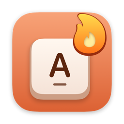</p>

<h1 align="center">TenFingers</h1>

<p align="center"><b>Learn to touch type with all ten fingers, in English and Russian.</b><br>
A free touch-typing tutor for macOS: a full course, training built from your mistakes, daily streaks and a rhythm game.</p>

<p align="center">
  <a href="https://github.com/Rusl3n/tenfingers/releases/latest"></a>
</p>

<p align="center">
  
  <a href="https://github.com/Rusl3n/tenfingers/releases"></a>
  <a href="https://github.com/Rusl3n/tenfingers/actions/workflows/tests.yml"></a>
  <a href="LICENSE"></a>
  <a href="https://pay.cloudtips.ru/p/83c3e4e3"></a>
</p>

<p align="center">
  <a href="README.md">Русский</a> ·
  <a href="docs/FEATURES.en.md">All features</a> ·
  <a href="docs/INSTALL.en.md">Installation</a> ·
  <a href="CHANGELOG.md">Changelog</a> (in Russian)
</p>

<p align="center">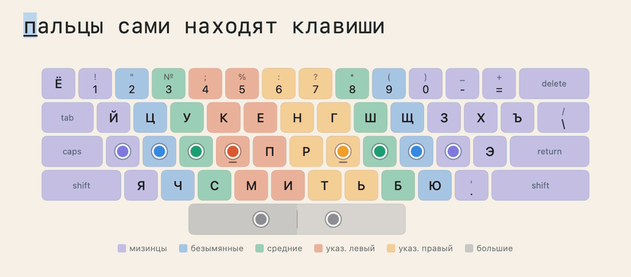</p>

## Why TenFingers

- **A real course, not a pile of drills.** 98 lessons per language, from the home row to long texts, with stars, stage checks and a certificate at the end.
- **Your keyboard on screen.** The app draws your actual layout and highlights the key and the finger, and the hints fade out until you're typing blind.
- **Trains what you get wrong.** A breakdown after every step, adaptive training, weak spots and the very words you keep mistyping.
- **Helps you stick with it.** A 10-minute plan for today, a daily streak with freezes, levels, challenges and 164 achievements, each with its own joke.
- **More than lessons.** Rhythm, a game with notes to the beat; a speed test with a replay of your typing; practice on classic literature or your own text.
- **Free and offline.** No subscription, ads or accounts; your progress stays on your Mac.

## Screenshots

**Home.** Daily streak, Spark, level and today's plan.

<p align="center">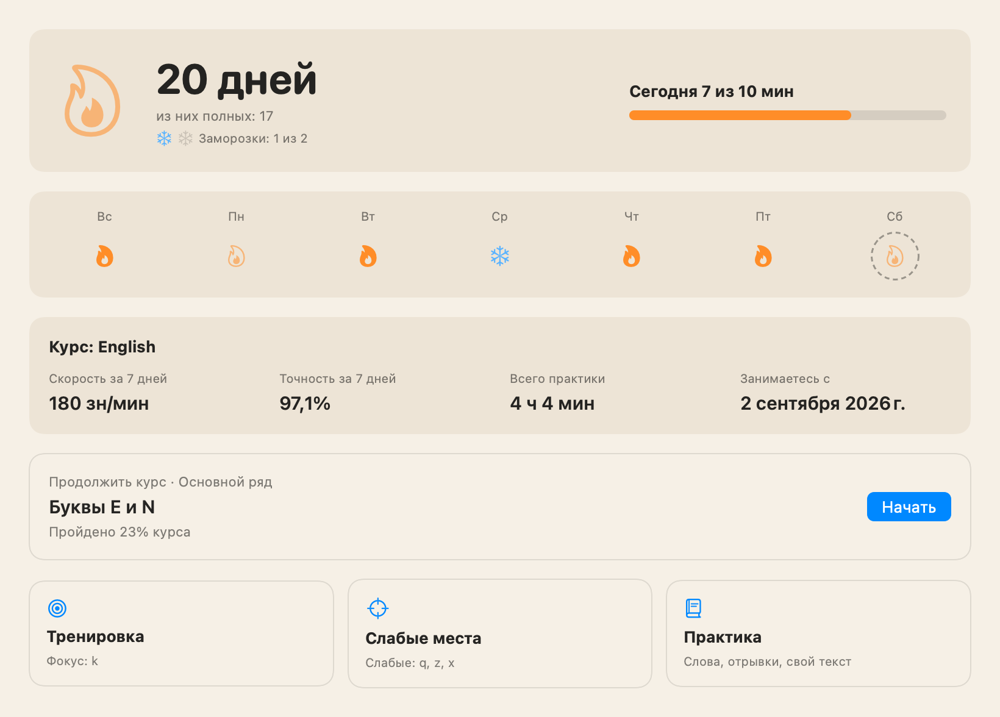</p>

**Course.** 98 lessons in 7 stages: stars, speed and Refresh on weakly passed lessons.

<p align="center">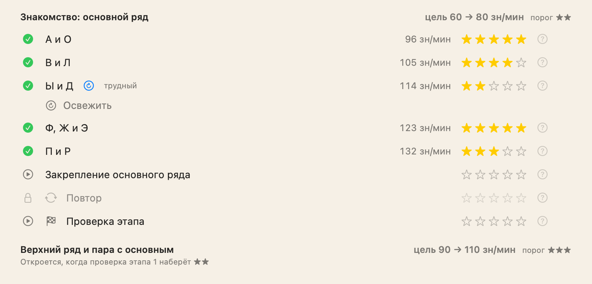</p>

**Step breakdown.** Where your speed dropped, which letters had errors and what's next.

<p align="center">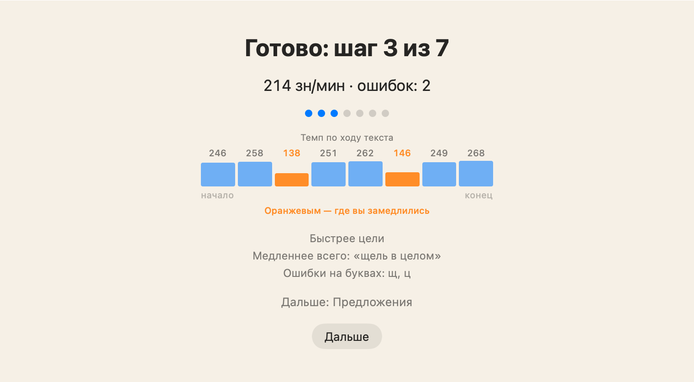</p>

**Rhythm.** Letters travel down the finger lanes; hit them to the beat.

<p align="center">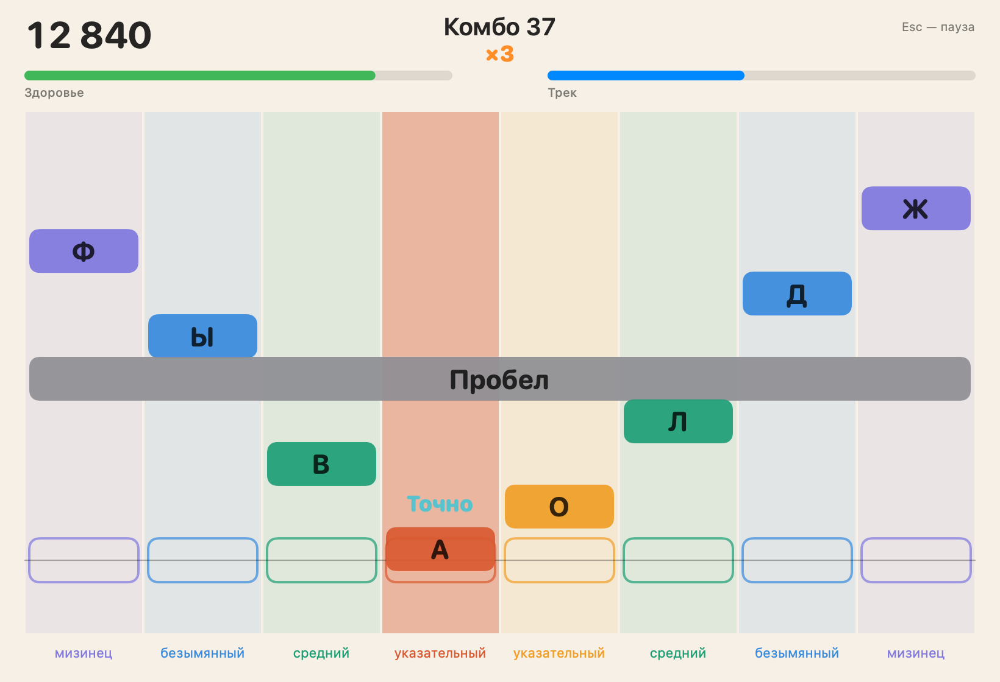</p>

**Speed test.** Compared with your first and previous test, with progress on a chart.

<p align="center">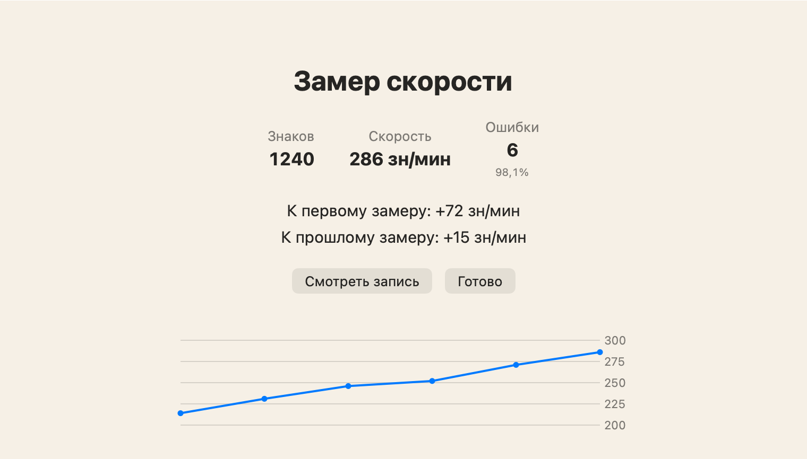</p>

**Achievements.** 164 achievements, each with its own joke; some are secret.

<p align="center">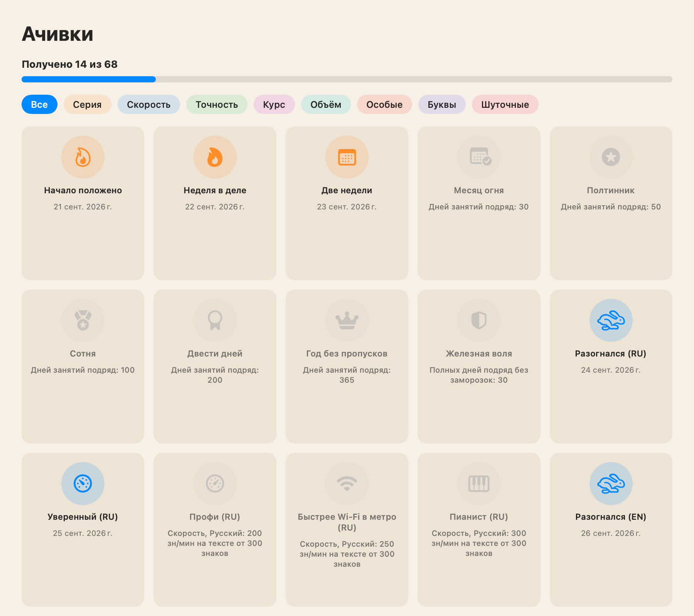</p>

**Share cards.** A streak, record, stage or progress as an image for stories and chats.

<p align="center">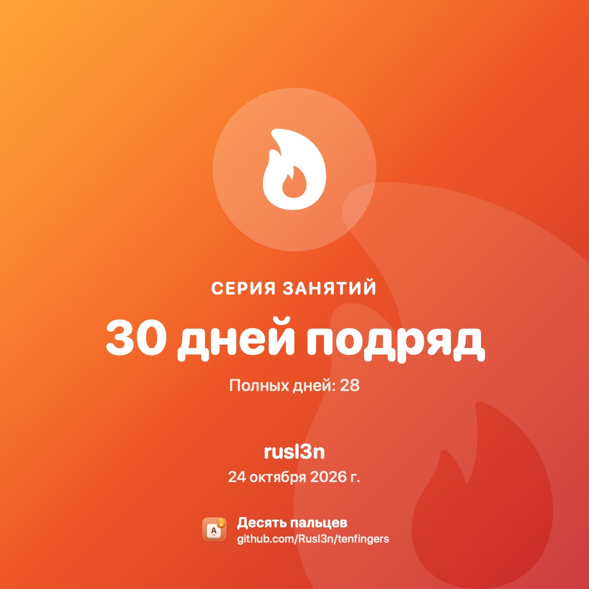</p>

<p align="center">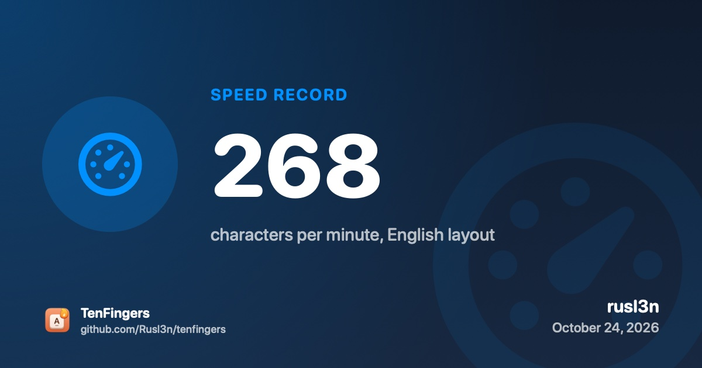</p>

**Widget.** Streak, daily goal and latest achievements on your desktop.

<p align="center">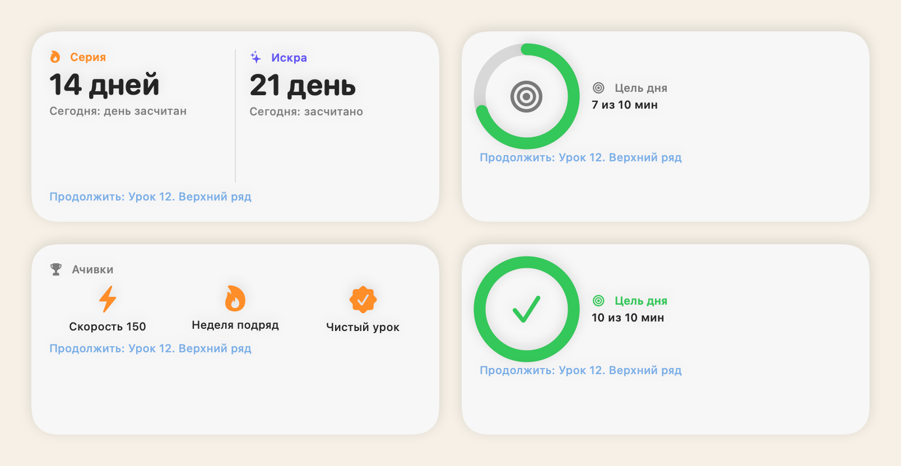</p>

**Analytics.** A keyboard heat map of errors, charts, records and a calendar.

<p align="center">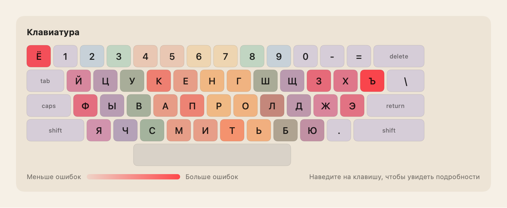</p>

**Settings.** Themes and palettes, scale, sounds, reminders, profiles.

<p align="center">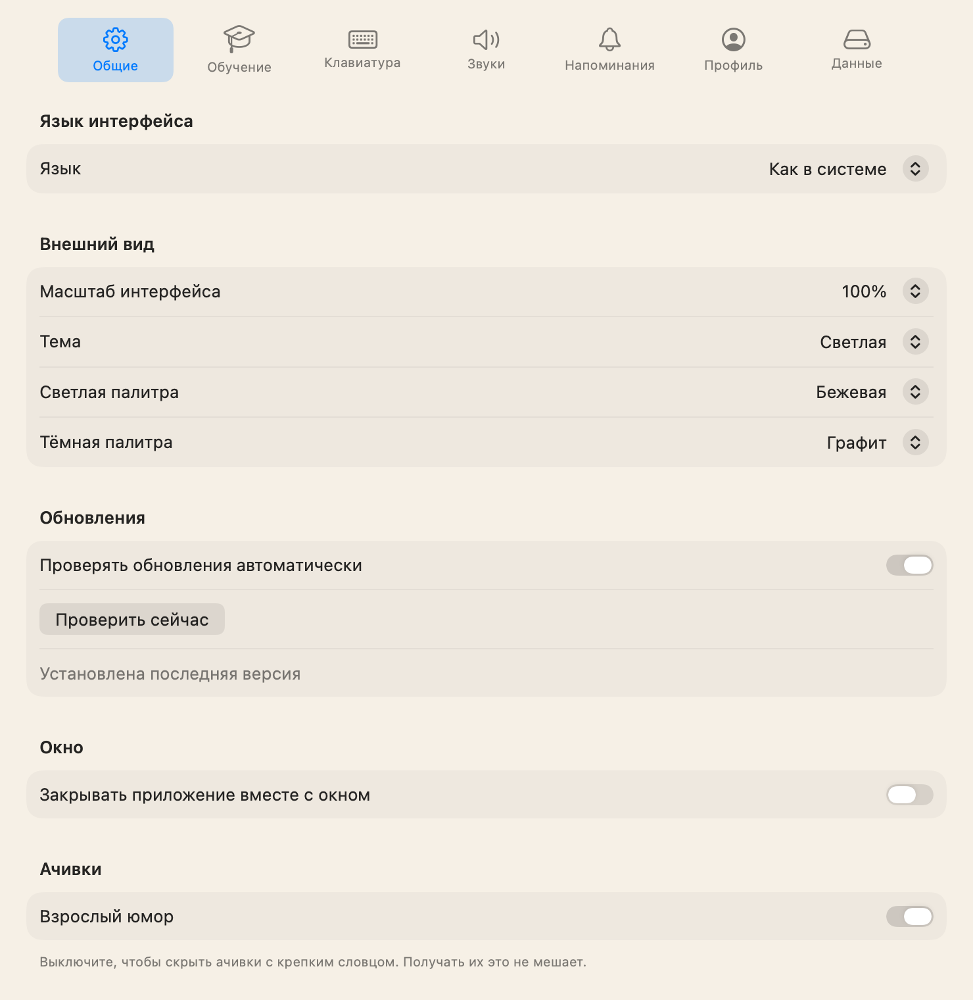</p>

**Dark theme.** Six palettes, light and dark, following the system or on a schedule.

<p align="center">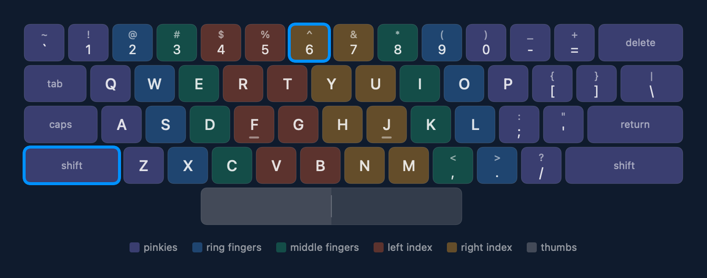</p>

<sub>Images are rendered by the app's tests from made-up data, with the Russian interface; the app is fully available in English.</sub>

<p align="center"><b><a href="docs/FEATURES.en.md">All features and screenshots →</a></b></p>

## Installation

1. Download `TenFingers-<version>.dmg` from the [latest release](https://github.com/Rusl3n/tenfingers/releases/latest) and drag TenFingers into Applications.
2. On first launch macOS warns that it can't verify the app: it's free and doesn't go through Apple's paid notarization. Allow it once under **System Settings → Privacy & Security → Open Anyway**.
3. From then on the app updates itself.

Requires macOS 15 or later and a Mac with Apple silicon (M1 or later). **[Detailed guide: installation, first-time setup, moving your progress and building from source →](docs/INSTALL.en.md)**

## Support the project

TenFingers is free and open source. If it helps you, you can support development with a voluntary donation via [CloudTips](https://pay.cloudtips.ru/p/83c3e4e3). CloudTips currently accepts cards issued by Russian banks only. A donation does not unlock anything in the app; it is simply a thank-you.

Found a bug or have an idea? [Open an issue](https://github.com/Rusl3n/tenfingers/issues/new/choose).

## For developers

<details>
<summary>Building, testing and project layout</summary>

You need Xcode 26 at `/Applications/Xcode.app`.

```bash
git clone https://github.com/Rusl3n/tenfingers.git
cd tenfingers
./scripts/build-app.sh   # build and install into /Applications, backing up your progress
swift test               # tests (needs export DEVELOPER_DIR=/Applications/Xcode.app/Contents/Developer)
```

A Swift package with four modules:

- `TypingCore`: pure logic without AppKit or SwiftUI: keyboard geometry, typing engine, course, text generation, achievements, sound synthesis. Covered by tests.
- `TenFingers`: the app: SwiftUI, keyboard layouts via TIS, SwiftData storage, updates.
- `WidgetSnapshot`: the widget data model shared by the app and the widget.
- `TenFingersWidget`: the WidgetKit extension.

README images are rendered by tests: `RENDER_DOCS=1 swift test --filter render…` (see `Tests/TenFingersTests/ReadmeImages.swift`).

More: [building from source](docs/INSTALL.en.md#building-from-source), [contributing](CONTRIBUTING.en.md), [changelog](CHANGELOG.md) (in Russian).

</details>

## Licenses

- Code: [MIT](LICENSE).
- Word lists `Sources/TypingCore/Resources/words-*.txt`: adapted from [hermitdave/FrequencyWords](https://github.com/hermitdave/FrequencyWords) (OpenSubtitles 2018), [CC BY-SA 4.0](https://creativecommons.org/licenses/by-sa/4.0/).
- Sentences `Sources/TypingCore/Resources/sentences-*.json`: from [Tatoeba](https://tatoeba.org), [CC BY 2.0 FR](https://creativecommons.org/licenses/by/2.0/fr/).
- Practice excerpts: public-domain works ([Project Gutenberg](https://www.gutenberg.org), [Wikisource](https://ru.wikisource.org)).
- Details: [`CREDITS.md`](Sources/TypingCore/Resources/CREDITS.md). The icon is drawn in code: [`scripts/make-icon.swift`](scripts/make-icon.swift).
