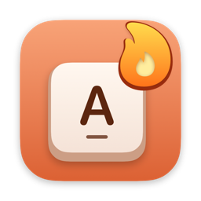
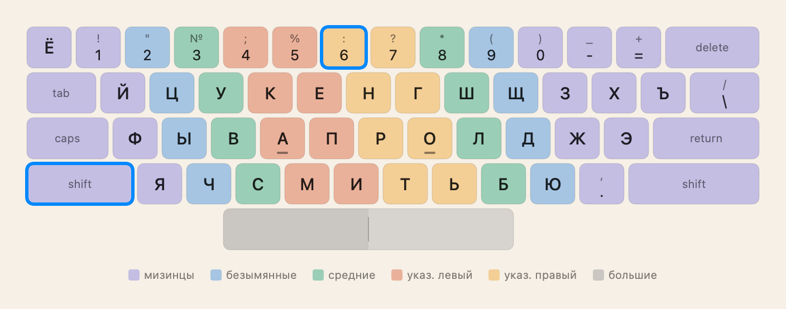
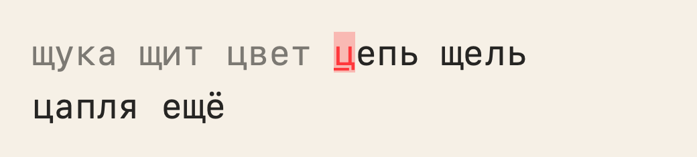
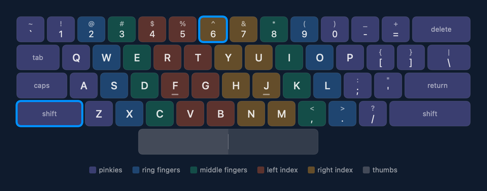

<p align="center"></p>

<h1 align="center">Десять пальцев</h1>

<p align="center">Тренажёр слепой десятипальцевой печати для macOS — русская и английская раскладки.</p>

<p align="center"><a href="README.en.md">English version</a></p>



## Возможности

- Курс по урокам: по 5 этапов для русского и английского языков.
- Экранная клавиатура в вашей реальной раскладке (в том числе переназначенные символы, например Shift+6 = «:» в «Русская – ПК») и в цветах пальцев. Размер клавиатуры настраивается.
- Ошибка останавливает курсор: сначала нужно нажать правильную клавишу.
- Подсказки с постепенным отказом от них: от подсвеченной клавиши и пальца к печати вслепую.
- Индикатор шагов урока и подробный итог упражнения.
- Крупная скорость по центру экрана упражнения: зелёная, если вы не медленнее цели, красная, если медленнее; стрелка вверх или вниз рядом с целью дублирует цвет.
- Адаптивная тренировка: буквы открываются по мере освоения, упор на самую слабую.
- «Слабые места»: 5 минут на ваши худшие клавиши и сочетания.
- Практика: частотные слова, 24 отрывка классики (по 12 на язык), цифры и символы, свой текст из буфера обмена или .txt-файла (в том числе в Windows-1251) с запоминанием места.
- Esc ставит упражнение на паузу и открывает боковое меню; в другом разделе Esc возвращает к уроку на паузе.
- Настройки по разделам; при перетаскивании ползунков размера и сдвига поверх экрана появляется предпросмотр клавиатуры в полный размер.
- Скорость и точность по каждой клавише собираются при печати; на экране итога видны клавиши с наибольшим числом ошибок.
- Звуки, которые синтезируются в приложении: щелчок, ошибка, конец упражнения, урок пройден. У каждого звука своя громкость и выключатель.
- Светлые (белая, бежевая, серая) и тёмные (графит, ночь, кофе) палитры; тема по системе, вручную или по расписанию.
- Английский интерфейс; язык выбирается в настройках системы.
- Все данные хранятся локально: ни сети, ни аккаунтов, ни телеметрии.

### В разработке

- Серия дней с полным и половинным огнём и заморозками, подробная аналитика по клавишам, пальцам и биграммам, напоминания.
- Ачивки, в том числе шуточные.

## Как это выглядит





## Установка из исходников

Требования: macOS 15 и новее, Xcode 26 и новее.

```bash
git clone https://github.com/Rusl3n/tenfingers.git
cd tenfingers
./scripts/build-app.sh
```

Скрипт собирает релизную версию, подписывает её ad-hoc и копирует в `/Applications`. Приложение появится в «Программах» как «Десять пальцев».

## Разработка

```bash
export DEVELOPER_DIR=/Applications/Xcode.app/Contents/Developer
swift test
```

Пакет Swift состоит из двух модулей:

- `TypingCore` — чистая логика без AppKit и SwiftUI: геометрия клавиатуры, карта пальцев, движок печати, курс, генерация текста, синтез звуков. Покрыта тестами.
- `TenFingers` — приложение: интерфейс SwiftUI, раскладка через TIS, хранилище SwiftData, звуки, темы.

Картинки для README рендерятся тестом, который по умолчанию пропускается:

```bash
RENDER_DOCS=1 swift test --filter renderReadmeImages
```

Дизайн и планы работ лежат в [`docs/superpowers`](docs/superpowers): [спецификация](docs/superpowers/specs/2026-10-23-typing-tutor-design.md) и [планы](docs/superpowers/plans).

## Лицензии

- Код — [MIT](LICENSE). Лицензия MIT распространяется на код, но не на списки слов.
- Списки слов `Sources/TypingCore/Resources/words-*.txt` — отфильтрованные адаптации частотных словарей [hermitdave/FrequencyWords](https://github.com/hermitdave/FrequencyWords) (OpenSubtitles 2018), лицензия [CC BY-SA 4.0](https://creativecommons.org/licenses/by-sa/4.0/). См. также [`CREDITS.md`](Sources/TypingCore/Resources/CREDITS.md).
- Иконка нарисована кодом: [`scripts/make-icon.swift`](scripts/make-icon.swift).
