# All features

[Русская версия](FEATURES.md) · [← Back to README](../README.en.md)

- [Course](#course)
- [On-screen keyboard and hints](#on-screen-keyboard-and-hints)
- [Training](#training)
- [Practice](#practice)
- [Rhythm](#rhythm)
- [Every day: plan, streak, levels](#every-day-plan-streak-levels)
- [Analytics](#analytics)
- [Achievements and Share cards](#achievements-and-share-cards)
- [Widget](#widget)
- [Comfort](#comfort)

The screenshots are rendered by the app's tests from made-up data, with the Russian interface; the app itself is fully available in English.

## Course

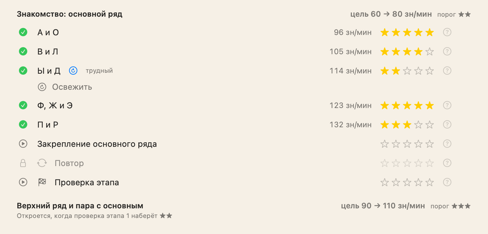

- **98 lessons per language** (English and Russian) in 7 stages, from the home row to long texts. Each lesson has 6–8 steps: words from the rows, phrases, sentences, connected text, hard letters, words with your errors, a sprint, numbers.
- **Review** is built from your errors; **Speed-up** uses your strong letters with a goal 10% above your average speed. Speed tiers start at stage two.
- **Five stars per lesson** for speed and errors. A "?" next to the stars explains the rules, and the result tells you how many errors stand between you and the next star.
- **A stage check** unlocks the next stage; you can take it right away. After all 7 stages you get a **certificate** with your average speed; its condition and your progress are visible in advance.
- **Strict steps:** no more than 4 errors per 100 characters, with an "errors N of M" counter while you type; exceed it and the step repeats.
- **Refresh:** weakly passed lessons come back after 1, 3 and 7 days; well-passed ones rotate into the warm-up.
- The course map shows errors, speed and stars for every lesson and step, lets you redo any step, and has **Lesson statistics**: every attempt and your speed growth.

### Breakdown after each step and lesson

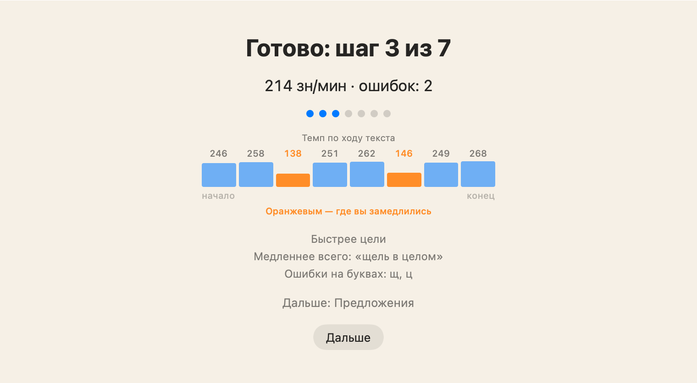

After each step: a speed chart by text segment (slow segments are highlighted; hover to see their words) and a couple of lines on what went well and what got in the way. At the end of a lesson: a full breakdown with speed per step, the best step, the letters and finger worth practicing, and a "What next" button.

## On-screen keyboard and hints

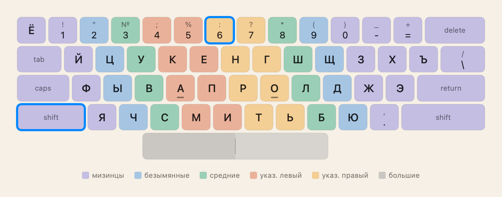

- **Your actual layout**, including remapped symbols (for example, Shift+6 = ":" in Russian – PC), colored by finger. The size is adjustable.
- **A mistake stops the cursor:** press the correct key first.
- **Hints fade out:** from a highlighted key and finger to typing blind. For the space bar, the half under the right thumb lights up.
- **Fingertips over the keyboard** when new keys are introduced.
- **A big speed readout** in the middle: green when you're at or above the goal, red when below.

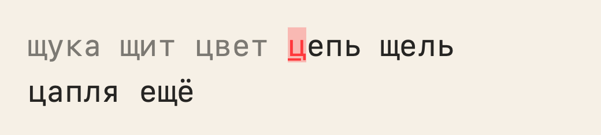

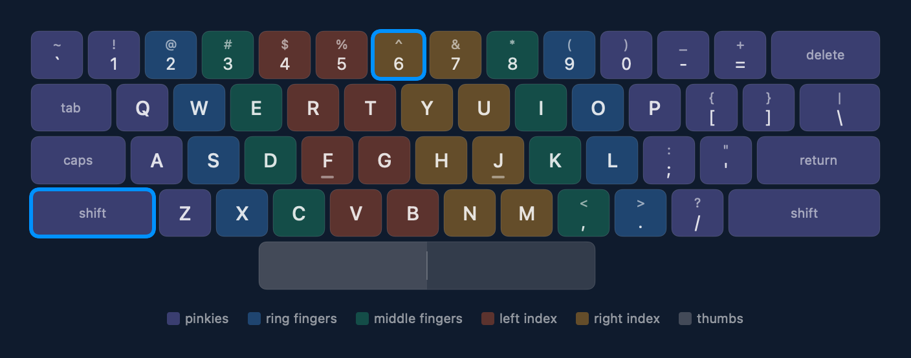

## Training

- **Adaptive training:** letters unlock as you master them, focusing on your weakest one.
- **Weak spots:** 5 minutes on your worst keys and key pairs.
- **Fingers:** a diagram of both hands with a score for each finger; "Finger accuracy" for weak ones and "Finger speed" for strong ones.
- **Words with errors:** the app remembers real dictionary words you get wrong (up to 200 per language) and marks a word fixed after three clean runs in a row.
- The "Letters in training" setting uses only letters unlocked in the course, or all of them.

### Speed test

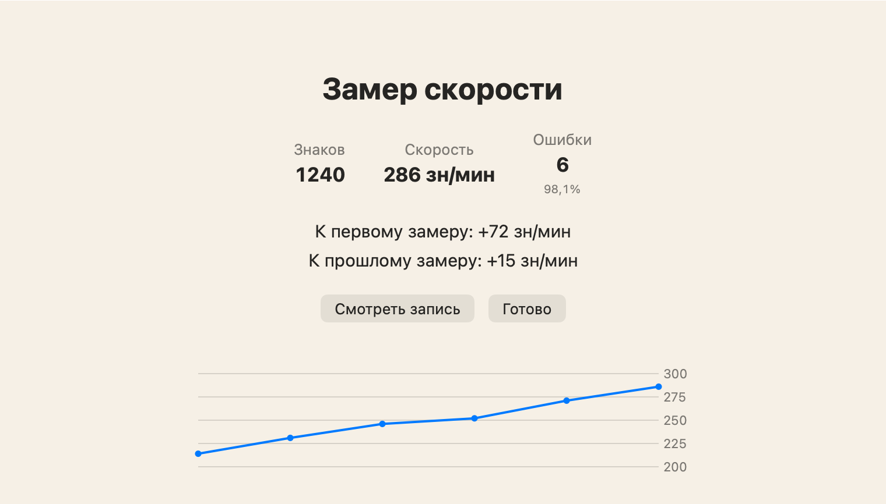

1, 2 or 5 minutes, or a 300-character text; plain, capitals and punctuation, or with digits; no Backspace. The result compares you with your first and previous test. **Watch replay** shows your typing with fingertips: as it was, ×1.5, ×2, ×3 and "Master" (1000 characters per minute).

## Practice

Frequent words, 120 excerpts from classic literature (60 per language), digits and symbols, and your own text from the clipboard or a `.txt` file (including Windows-1251); the app remembers where you stopped.

## Rhythm

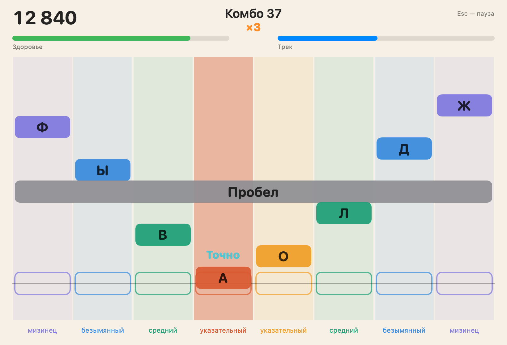

A rhythm game with falling notes: letters travel down eight finger lanes and you hit them to the beat.

- Four note modes: unlocked letters, locked letters, problem letters and words.
- Levels from Easy to Expert, "My pace" based on your typing speed, and "Endless" with a rising tempo.
- After each run: a breakdown of strong and weak letters, mix-ups and fingers, plus "Train weak letters". Records for every combination, and a "Sound offset" for laggy headphones.
- Minutes of play count toward your daily goal.

## Every day: plan, streak, levels

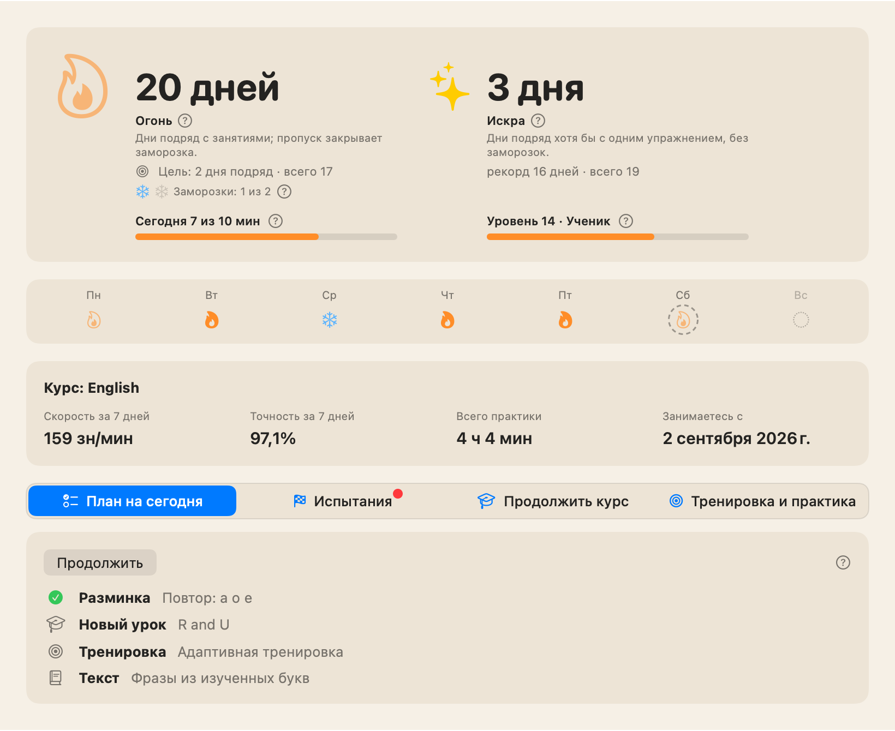

- **Today's plan:** warm-up, lesson, training and text, one item at a time; the plan's size depends on your daily goal.
- **Flame streak:** a full flame for reaching the daily goal (10 minutes of active typing by default), a half flame for any exercise. **Freezes** cover a missed day, and a **repair** saves the streak with a double goal the next day.
- **Spark:** a second streak where any finished exercise counts.
- **Levels and challenges:** experience for practice time, lessons, stars and full days; three weekly challenges and one monthly.
- The week strip, weekly speed and accuracy and your latest achievement are all on Home.

## Analytics

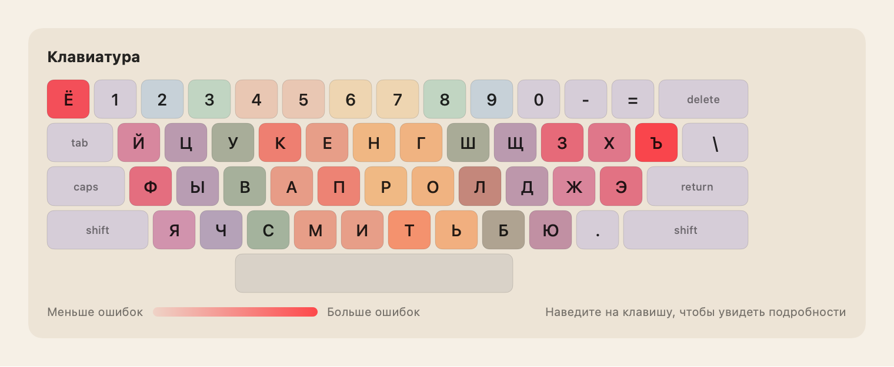

Speed and accuracy charts with a trend line, a keyboard heat map of errors and slow keys, per-finger statistics, a year-long activity calendar, records, exercise history, course progress and weekly experience.

## Achievements and Share cards

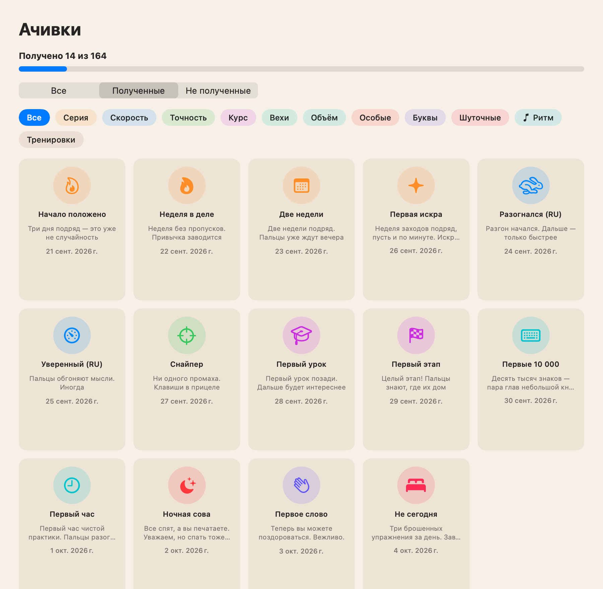

- **164 achievements** in eleven categories: streak, speed, accuracy, course, milestones, volume, special, letters, jokes, Rhythm and training. Each comes with a joke; 32 are secret. Repeatable ones can be earned many times ("×N").
- The "Adult humor" setting hides achievements with strong language.
- **Share cards:** an achievement, a speed record, a stage or the course, and "My Progress" with a calendar. Light or dark; wide, square or vertical for stories; optionally with a QR code. Copy, save as PNG or send.

  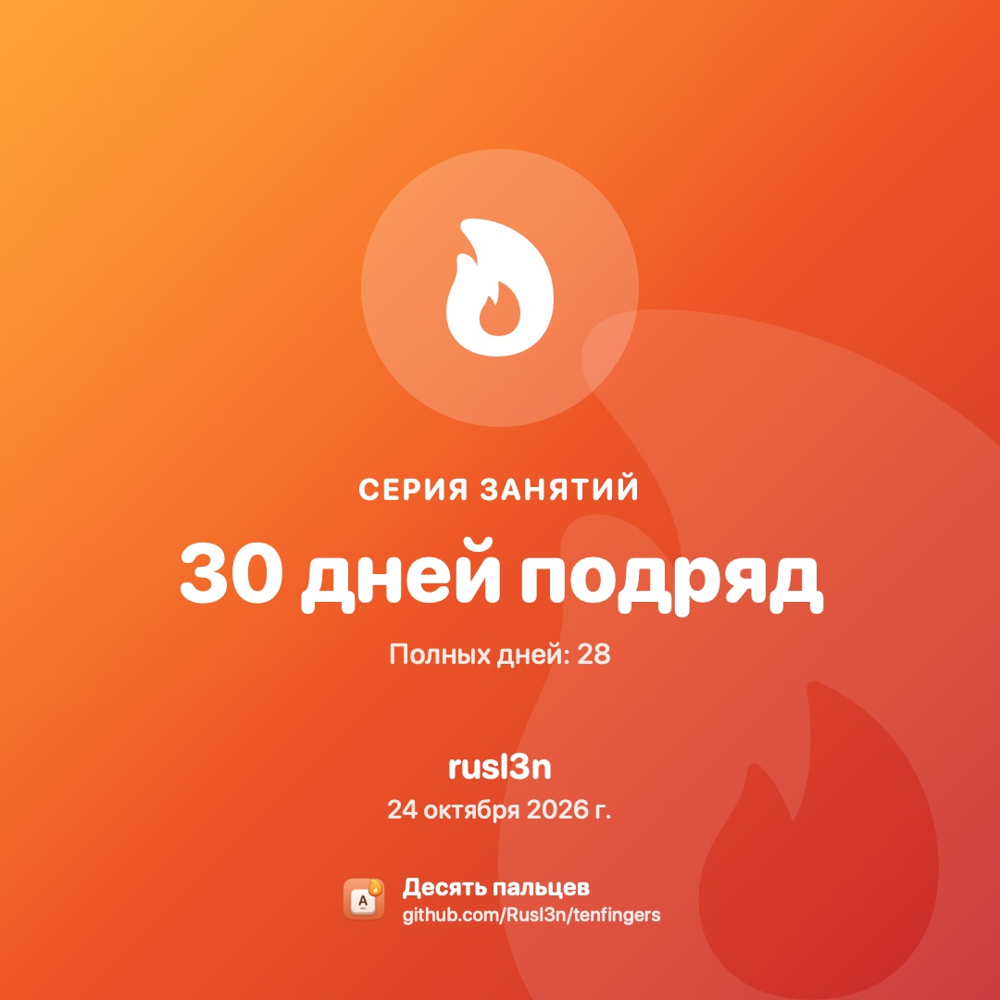
  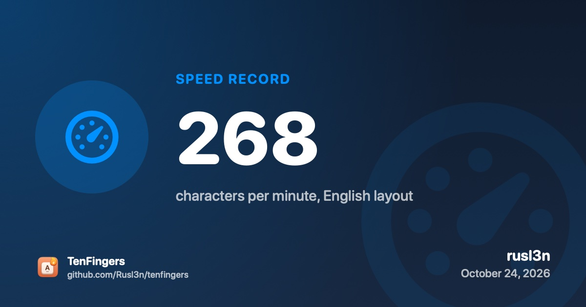

## Widget

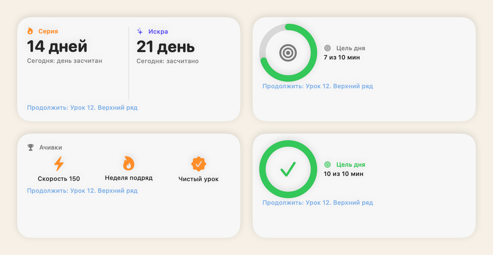

Small and medium desktop widgets: streak, daily goal and latest achievements. Pages rotate on their own or on click, and a click opens the matching section of the app.

## Comfort

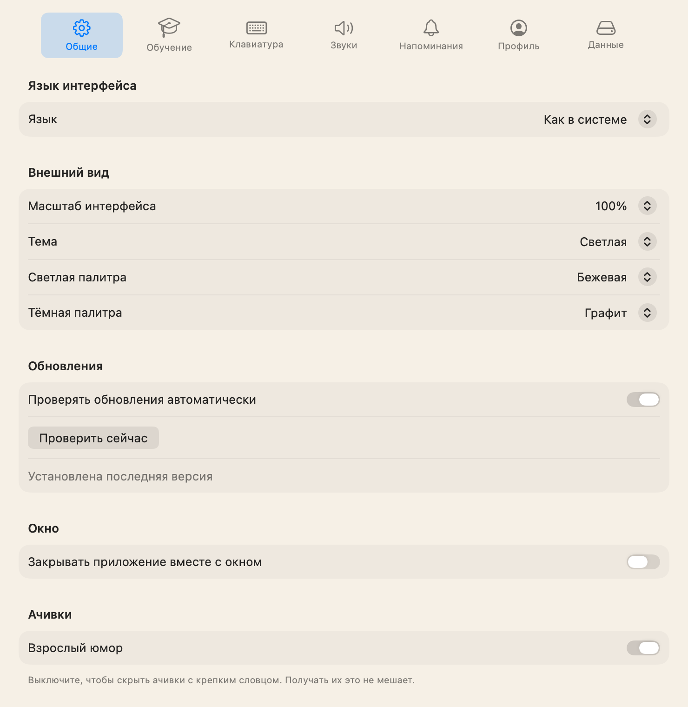

- **Profiles:** several learners on one Mac, each with their own progress, streak, achievements and settings.
- **Reminders:** once a day, three times a day or every N hours within a time window; plain, playful or mixed tone; the text knows about your streak.
- **Sounds** are synthesized inside the app, each with its own volume.
- **Themes:** light (white, beige, gray) and dark (graphite, night, coffee) palettes, following the system, manual or on a schedule. Interface scale 80–150%.
- **Esc** pauses an exercise.
- **Moving progress** to another Mac through a file, with automatic backups.
- **In-app updates** in one click, with a progress backup.
- **Interface** in English and Russian.
