# Все возможности

[English version](FEATURES.en.md) · [← На главную](../README.md)

- [Курс](#курс)
- [Экранная клавиатура и подсказки](#экранная-клавиатура-и-подсказки)
- [Тренировки](#тренировки)
- [Практика](#практика)
- [«Ритм»](#ритм)
- [Каждый день: план, серия, уровни](#каждый-день-план-серия-уровни)
- [Аналитика](#аналитика)
- [Ачивки и карточки «Поделиться»](#ачивки-и-карточки-поделиться)
- [Виджет](#виджет)
- [Удобство](#удобство)

Картинки нарисованы тестами приложения на вымышленных данных.

## Курс

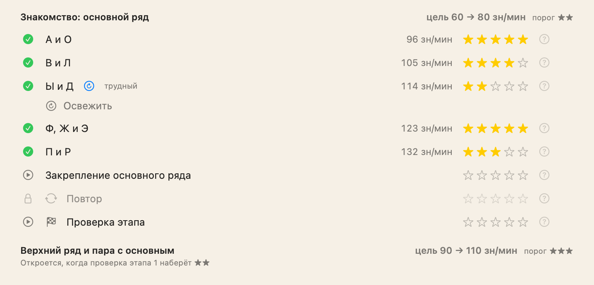

- **98 уроков на каждый язык** (русский и английский) в 7 этапах — от основного ряда до длинных текстов. В уроке 6–8 шагов: слова из рядов, фразы, предложения, связный текст, трудные буквы, слова с ошибками, спринт, числа.
- **«Повтор»** строится по вашим ошибкам, **«Ускорение»** — на сильных буквах с целью на 10% выше вашей средней скорости. Со второго этапа — ступени скорости.
- **Пять звёзд за урок** — за скорость и ошибки. «?» рядом со звёздами объясняет правила, итог подсказывает, сколько ошибок мешает до следующей звезды.
- **Проверка этапа** открывает следующий этап; её можно сдать сразу, экстерном. После всех 7 этапов — **сертификат** с вашей средней скоростью; условие и прогресс видны заранее.
- **Строгий шаг:** не больше 4 ошибок на 100 знаков, счётчик «ошибки N из M» виден во время набора; при переборе шаг повторяется.
- **«Освежить»:** слабо сданные уроки возвращаются через 1, 3 и 7 дней, хорошо сданные — ротацией в разминке.
- На карте курса — ошибки, скорость и звёзды по каждому уроку и шагу, повтор любого шага и **«Статистика урока»**: все проходы и рост скорости.

### Разбор после шага и урока

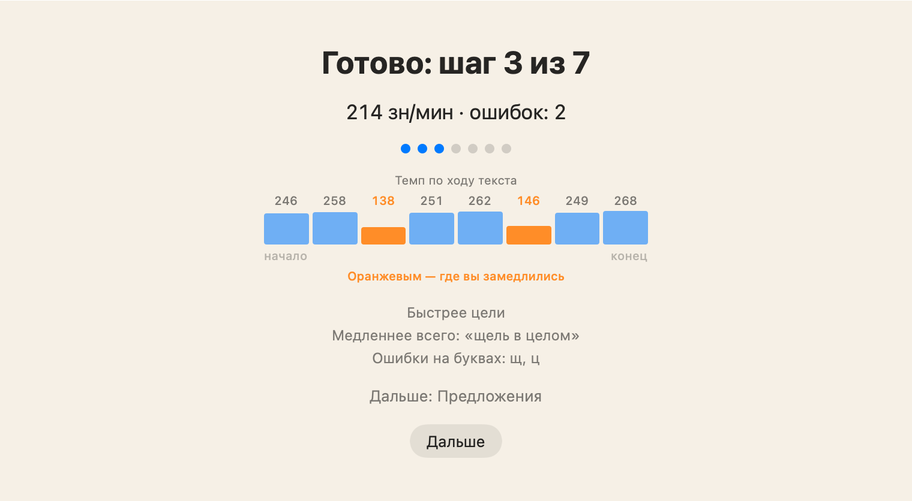

После каждого шага — график скорости по отрезкам текста (медленные выделены, при наведении видны их слова) и пара строк о том, что получилось и что мешало. На итоге урока — полный разбор: скорость по шагам, лучший шаг, буквы и палец, которые стоит подтянуть, и кнопка «Куда дальше».

## Экранная клавиатура и подсказки

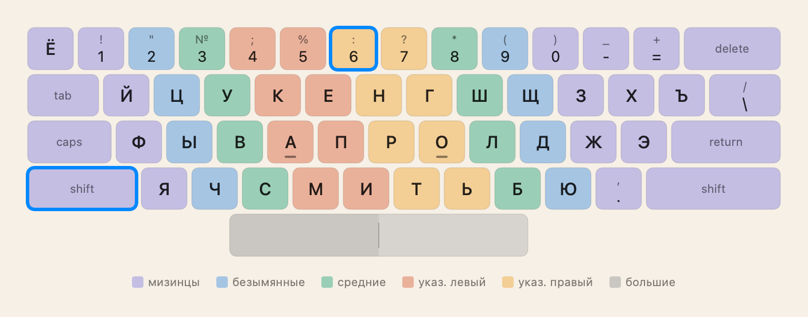

- **Ваша настоящая раскладка**, включая переназначенные символы (например, Shift+6 = «:» в «Русская – ПК»), в цветах пальцев. Размер настраивается.
- **Ошибка останавливает курсор:** сначала нужно нажать правильную клавишу.
- **Подсказки постепенно уходят:** от подсвеченной клавиши и пальца — к печати вслепую. Для пробела подсвечивается половина под нужным большим пальцем.
- **Кончики пальцев над клавиатурой** на знакомстве с новыми клавишами.
- **Крупная скорость** по центру: зелёная, если вы не медленнее цели, красная — если медленнее.

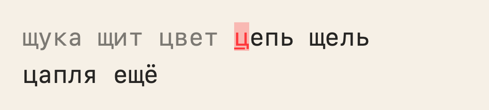

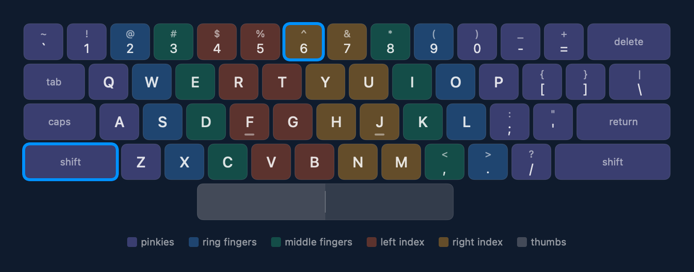

## Тренировки

- **Адаптивная тренировка:** буквы открываются по мере освоения, упор на самую слабую.
- **«Слабые места»:** 5 минут на ваши худшие клавиши и сочетания.
- **«Пальцы»:** схема рук с оценкой каждого пальца; «Точность пальца» для слабых и «Скорость пальца» для сильных.
- **«Слова с ошибками»:** приложение запоминает настоящие слова, в которых вы ошибаетесь (до 200 на язык), и считает слово исправленным после трёх чистых наборов подряд.
- Настройка «Буквы в тренировках» — только открытые в курсе буквы или все.

### Замер скорости

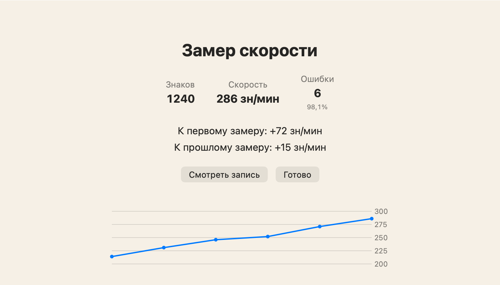

1, 2 или 5 минут либо текст в 300 знаков; виды «Простой», «Заглавные и знаки», «С цифрами»; без Backspace. На итоге — сравнение с первым и прошлым замером. **«Смотреть запись»** показывает ваш набор с кончиками пальцев: как было, ×1,5, ×2, ×3 и «Мастер» (1000 зн/мин).

## Практика

Частотные слова, 120 отрывков классики (по 60 на язык), цифры и символы, свой текст из буфера обмена или `.txt`-файла (в том числе в Windows-1251) — приложение помнит, где вы остановились.

## «Ритм»

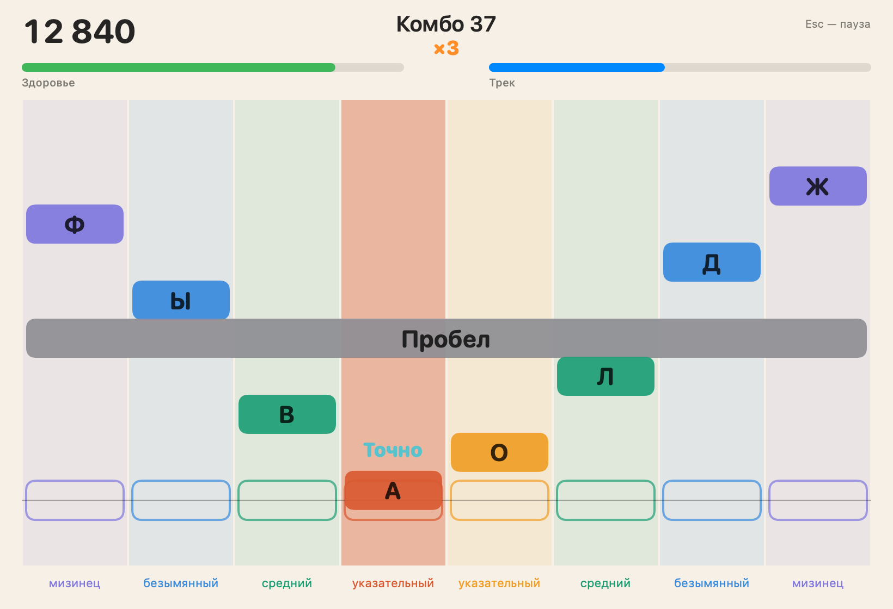

Ритм-игра с падающими нотами: буквы едут по восьми дорожкам пальцев, нажимать нужно в такт биту.

- Четыре режима нот: открытые, закрытые, проблемные буквы и слова.
- Уровни от «Лёгкого» до «Эксперта», «Под меня» — по вашей скорости, «Бесконечный» — с растущим темпом.
- После захода — разбор: сильные и слабые буквы, путаницы, пальцы и «Потренировать слабые». Рекорды по каждому сочетанию, «Сдвиг звука» для наушников с задержкой.
- Минуты игры идут в цель дня.

## Каждый день: план, серия, уровни

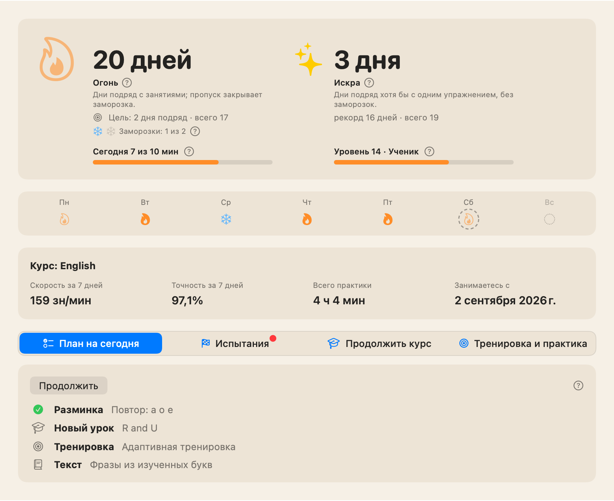

- **«План на сегодня»:** разминка, урок, тренировка и текст — по одному пункту, размер плана зависит от цели дня.
- **Серия «Огонь»:** полный огонь — за дневную цель (по умолчанию 10 минут чистого времени), половинный — за любое упражнение. **Заморозки** закрывают пропущенный день, **починка** спасает серию двойной целью на следующий день.
- **«Искра»** — вторая серия: день засчитан за любое завершённое упражнение.
- **Уровни и испытания:** опыт за время занятий, уроки, звёзды и полные дни; три испытания недели и одно — месяца.
- Лента недели, скорость и точность за неделю, последняя ачивка — всё на «Главной».

## Аналитика

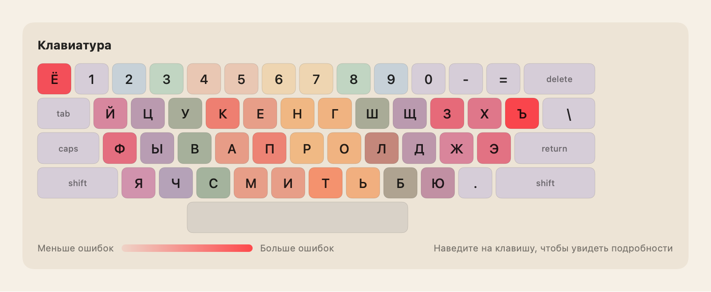

Графики скорости и точности с линией тренда, тепловая карта клавиатуры по ошибкам и медленным клавишам, статистика по пальцам, календарь занятий за год, рекорды, история упражнений, прогресс курсов и опыт по неделям.

## Ачивки и карточки «Поделиться»

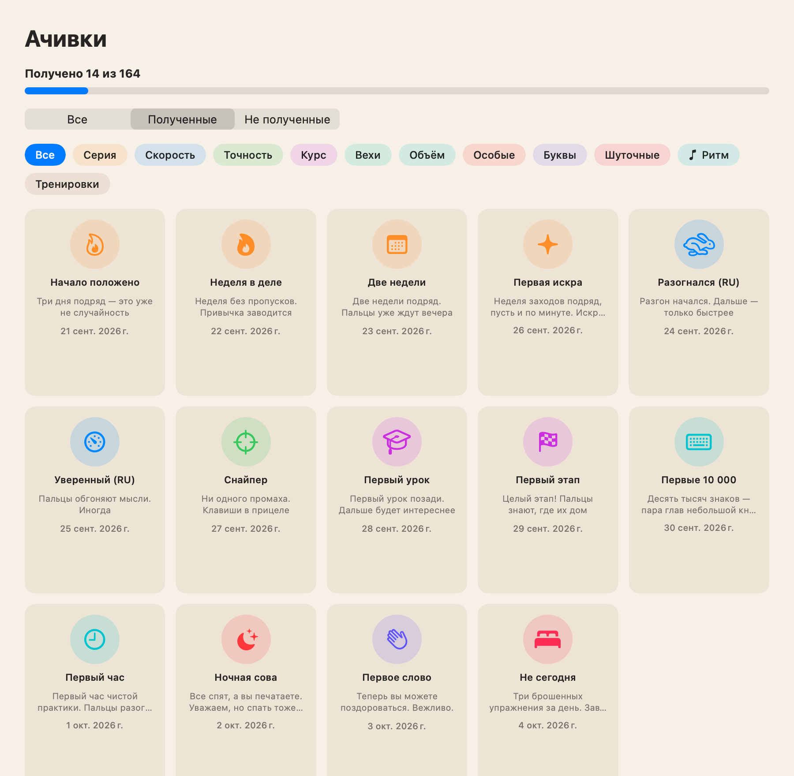

- **164 ачивки** в одиннадцати категориях: серия, скорость, точность, курс, вехи, объём, особые, буквы, шуточные, «Ритм» и тренировки. У каждой — шутка; 32 — секретные. Повторяемые получаются много раз («×N»).
- Настройка «Взрослый юмор» скрывает ачивки с крепким словцом.
- **Карточки «Поделиться»:** ачивка, рекорд скорости, этап или курс и «Мой прогресс» с календарём — светлые или тёмные, широкие, квадратные или вертикальные для сторис, по желанию с QR-кодом. Копировать, сохранить в PNG или отправить.

  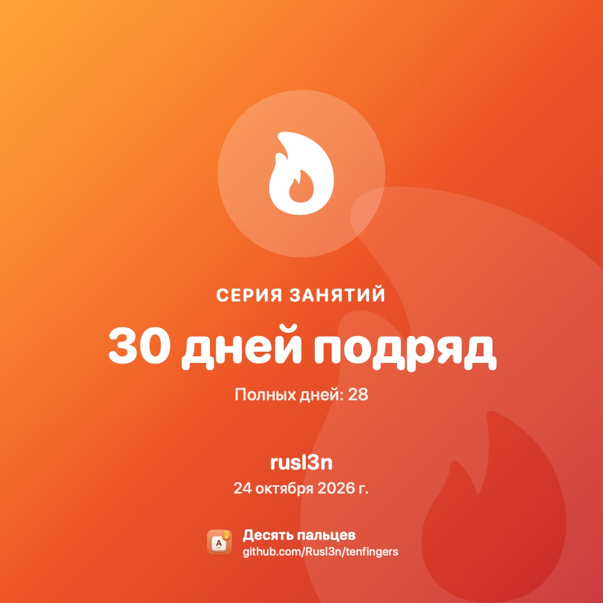
  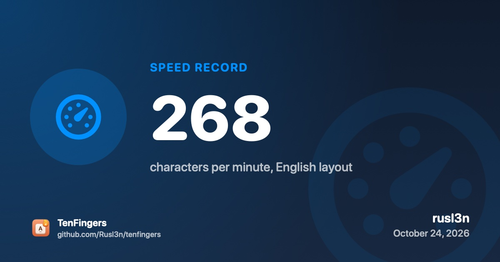

## Виджет

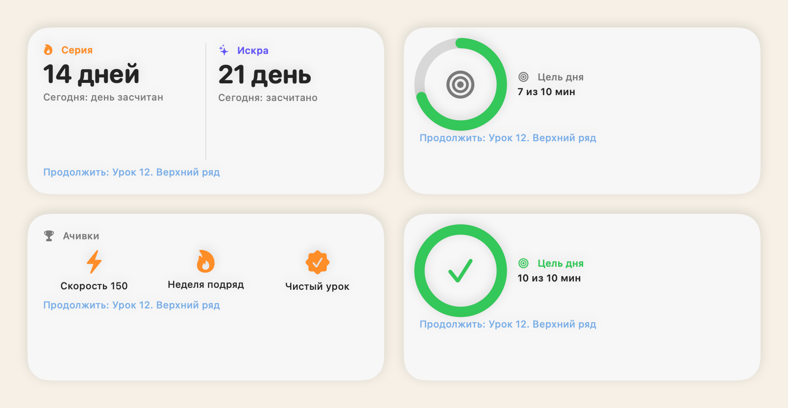

Маленький и средний виджет для рабочего стола: серия, цель дня и последние ачивки; страницы сменяются сами или по нажатию. Нажатие открывает нужный раздел приложения.

## Удобство

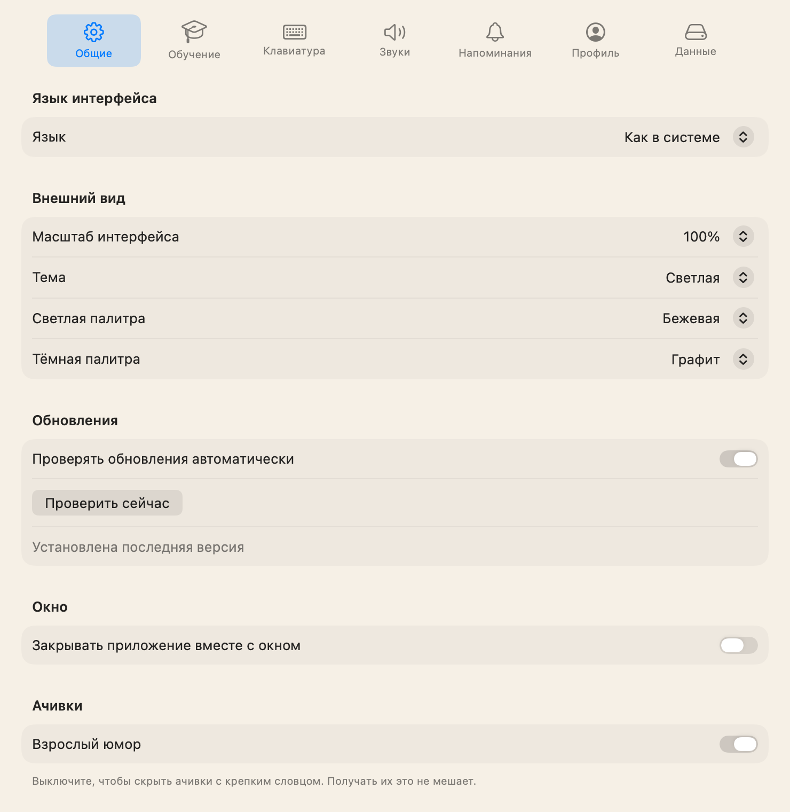

- **Профили:** несколько учеников на одном Mac, у каждого свой прогресс, серия, ачивки и настройки.
- **Напоминания:** раз в день, трижды в день или каждые N часов в заданном окне; тон — обычный, шуточный или вперемешку; текст учитывает серию.
- **Звуки** синтезируются в самом приложении, у каждого — своя громкость.
- **Темы:** светлые (белая, бежевая, серая) и тёмные (графит, ночь, кофе) палитры, по системе, вручную или по расписанию. Масштаб интерфейса 80–150%.
- **Esc** ставит упражнение на паузу.
- **Перенос прогресса** на другой Mac через файл, автоматические резервные копии.
- **Обновления из приложения** в одно нажатие, с резервной копией прогресса.
- **Интерфейс** на русском и английском.
